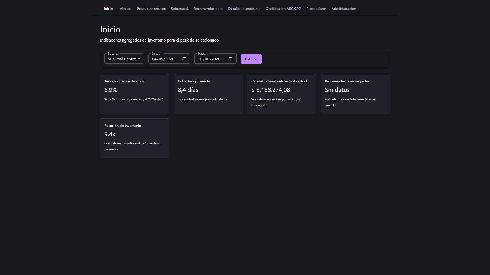
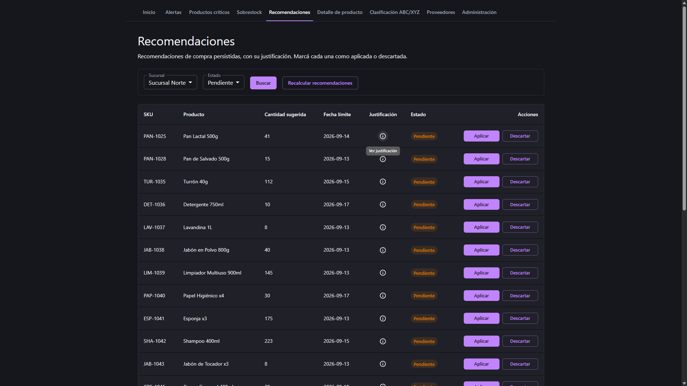
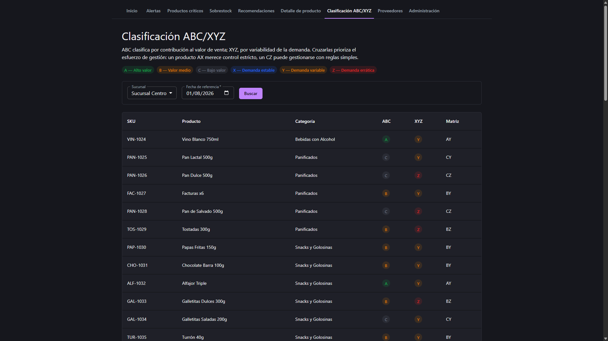

# InventoryIQ

[](https://github.com/Facugl/inventoryiq/actions/workflows/ci.yml)
[](LICENSE)

Herramienta de soporte a la decisión de compras para un supermercado: convierte
datos de ventas e inventario en recomendaciones de reposición (qué comprar,
cuándo y en qué cantidad). Ver `docs/InventoryIQ_Documentacion.md` para la
visión completa del producto y `docs/InventoryIQ_Arquitectura.md` para lo
efectivamente implementado (auditado contra el código).

## Requisitos

- [Docker Desktop](https://www.docker.com/products/docker-desktop/) (incluye Docker Compose).

No hace falta instalar Java, Node ni PostgreSQL por separado: todo corre en contenedores.

## Arranque rápido

```bash
cp .env.example .env
docker compose up -d --build
```

La primera vez tarda unos minutos (build de backend y frontend). Cuando termine:

- **Frontend:** http://localhost:5173
- **Backend (health check):** http://localhost:8080/health
- **Backend (API):** http://localhost:8080/api/v1/...
- **Backend (documentación interactiva — Swagger UI):** http://localhost:8080/swagger-ui/index.html
- **Backend (spec OpenAPI cruda, JSON):** http://localhost:8080/v3/api-docs

Los tres servicios (`postgres`, `backend`, `frontend`) quedan corriendo en segundo
plano. Para ver los logs: `docker compose logs -f backend` (o `frontend`, `postgres`).

Para bajar todo: `docker compose down` (agregá `-v` si además querés borrar los
datos de Postgres).

## Pantallas

- **Inicio** — KPIs agregados del período elegido (tasa de quiebre de stock, cobertura promedio, capital inmovilizado en sobrestock, % de recomendaciones seguidas, rotación de inventario).
- **Alertas** — productos en quiebre de stock o sobrestock que necesitan atención ya, con severidad.
- **Productos críticos** — productos que cruzaron el punto de pedido, ordenados por score de urgencia. Click en el SKU abre el Detalle de producto.
- **Sobrestock** — productos con cobertura excesiva y su capital inmovilizado, candidatos a liquidación o promoción.
- **Recomendaciones** — sugerencias de compra ya calculadas y persistidas, cada una con su justificación (fórmula y datos usados) y botones para marcarla aplicada o descartada.
- **Detalle de producto** — proyección de venta diaria de un producto puntual, ajustada por estacionalidad.
- **Clasificación ABC/XYZ** — matriz de prioridad: ABC por contribución al valor de venta, XYZ por variabilidad de demanda.
- **Proveedores** — catálogo de proveedores activos, con lead time editable y condición de pago.
- **Administración** — conteo manual de stock, carga de ventas o inventario por CSV (el tipo se elige al subir el archivo), disparo manual del recálculo diario, y edición de parámetros de categoría (umbral de sobrestock, stock de seguridad extra).

### Capturas

| Inicio | Recomendaciones | Clasificación ABC/XYZ |
|---|---|---|
|  |  |  |

## Datos

El sistema arranca con un catálogo **simulado** (`data/csv/*.csv`): productos,
categorías, sucursales, ventas e inventario ficticios pero realistas (ver
`docs/README_datos_simulados.md`). Sirven para navegar y probar todas las
pantallas sin depender de datos reales.

### Cargar tu catálogo real

El catálogo real **no se carga a mano ni se versiona**: lo produce el pipeline
ETL de [`etl/`](etl/), que convierte los exports crudos del POS XRP
(`data/real-export/`, fuera de git) al mismo formato de `data/csv/*.csv` que ya
consumen los adaptadores del backend — sin tocar el backend ni el dominio.

```bash
cd etl && python -m inventoryiq_etl migrar
```

La salida va a `data/csv-real/`, que **está fuera de git a propósito**: este
repositorio es público y el catálogo real trae costos, márgenes y proveedores
de un negocio real. `data/csv/` se queda con el dataset simulado, para que
cualquiera pueda clonar y levantar el sistema. Para apuntar el backend a la
carpeta real, cambiá el volumen del servicio `backend` en `docker-compose.yml`
a `./data/csv-real:/app/data/csv` (o fijá `INVENTORYIQ_CSV_BASE_PATH` si lo
corrés sin Docker) y reiniciá: `docker compose up -d backend`.

Las cuatro entidades que salen del POS —categorías, proveedores, productos e
inventario— están implementadas. **El catálogo todavía no es utilizable por un
único motivo:** ningún export del POS entrega la venta diaria por producto y
sucursal, así que `ventas.csv` se arrastra del dataset simulado y apunta a
productos que en el catálogo real no existen. `migrar` lo detecta, lo dice y
falla con código distinto de cero en vez de dejarte apuntar el backend a un
catálogo que no arrancaría. El detalle de qué decidió el pipeline en cada caso
está en [`etl/README.md`](etl/README.md) y, campo por campo, en
[`docs/InventoryIQ_ETL_Catalogo.md`](docs/InventoryIQ_ETL_Catalogo.md).

#### Qué exige el backend de cualquier catálogo

Vale tanto para el catálogo simulado como para el que produce el ETL, y explica
por qué varias decisiones del pipeline son las que son:

- **La carga de `productos.csv` y `categorias.csv` es todo-o-nada**: una sola
  fila rota y el backend no arranca. No hay tolerancia por fila, a diferencia
  de la carga de ventas o inventario desde la pantalla de Administración, que
  rechaza fila por fila hasta un umbral.
- **`categoria_id`** y **`proveedor_id`** son obligatorios en cada fila y tienen
  que apuntar a una categoría y a un proveedor que existan en `categorias.csv`
  y `proveedores.csv`. La pantalla de Proveedores lista los activos y permite
  corregir el lead time de cada uno a mano, pero no crearlos.
- **`lead_time_dias`** tiene que ser un número mayor a 0 en todas las filas. El
  POS no lo registra, así que el ETL aplica un default global corregible desde
  la pantalla de Proveedores (decisión 4.3 del doc del ETL).
- **`activo`** en `False` deja el producto fuera de todos los cálculos sin
  tener que borrarlo de la planilla.

## Verificación manual

Checklist para confirmar que un `docker compose up -d --build` levantó todo
correctamente, antes de probar las pantallas a mano:

1. **Los tres contenedores están arriba y sanos:**
   ```bash
   docker compose ps
   ```
   Esperado: `postgres` (healthy), `backend` y `frontend` en estado `Up`. Si
   alguno reinicia en loop, `docker compose logs -f <servicio>` muestra el error.

2. **El backend responde:**
   ```bash
   curl http://localhost:8080/health
   ```
   Esperado: `OK`.

3. **La API expone los endpoints esperados** — abrí
   http://localhost:8080/swagger-ui/index.html y confirmá que aparecen las 13
   secciones (Alertas, Categorías, Estado de productos, Forecast, Health,
   Ingesta CSV, Inventario, KPIs, Productos, Proveedores, Recomendaciones,
   Sucursales, Sugerencias de reposición). "Try it out" en `GET /api/v1/stores`
   o `GET /api/v1/suppliers` sin parámetros debería devolver 200 con datos.

4. **El frontend carga y llega al backend:** abrí http://localhost:5173 — si
   el catálogo de sucursales/categorías no carga, la pantalla lo dice
   explícitamente ("No se pudo cargar el catálogo..."), señal de que el
   frontend no está llegando al backend (revisar `VITE_BACKEND_URL` en
   `docker-compose.yml` y los logs de `frontend`).

5. **Recorré las 9 pantallas** desde la barra de navegación — con los datos
   simulados, todas deberían mostrar contenido (nunca una pantalla en blanco
   sin mensaje de error ni de "sin datos").

6. **Tests automatizados en verde** (no reemplazan la prueba manual, pero son
   la forma más rápida de detectar una regresión antes de perder tiempo
   navegando a mano):
   ```bash
   cd backend && ./mvnw test
   cd frontend && pnpm lint && pnpm test && pnpm build
   ```
   Los tests del backend necesitan Docker corriendo: varios de integración
   levantan un PostgreSQL efímero con Testcontainers.

## Desarrollo

- **Backend:** Java 17 + Spring Boot, arquitectura hexagonal. Tests: `cd backend && ./mvnw test`.
- **Frontend:** React + TypeScript + Vite + MUI, con TanStack Query, react-hook-form y yup.
  Tests con Vitest + Testing Library: `cd frontend && pnpm test` (`pnpm test:watch` para desarrollo).
  Lint y build: `pnpm lint && pnpm build`.
  El gestor de paquetes es **pnpm**, no npm: `npm install` rompe contra el `node_modules`
  con symlinks que deja pnpm.
- El frontend, dentro de Docker, usa `VITE_BACKEND_URL` para encontrar al backend
  (ver `docker-compose.yml`) y hot-reload vía polling (necesario en Docker Desktop
  para Windows/Mac — ver `frontend/vite.config.ts`).

## Despliegue

El sistema también está desplegado en Render (backend + frontend, ver `render.yaml`)
con PostgreSQL en Neon en vez del Postgres de Render (su free tier borra la base
a los 30 días; Neon está pensado para quedar meses sin uso constante sin perderla).

Limitaciones del plan free a tener en cuenta:

- **Sin disco persistente**: los CSV de `data/csv/` quedan embebidos en la imagen
  del backend en el build (`backend/Dockerfile`) — cualquier escritura hecha en
  vivo (conteo de stock, edición de lead time, parámetros de categoría) se pierde
  en el próximo reinicio/redeploy. Las recomendaciones sí persisten, porque viven
  en Postgres (Neon).
- **Cold start**: el backend (Spring Boot + Flyway + Hibernate) puede tardar más
  de 2 minutos en responder si estuvo inactivo. Un monitor de
  [UptimeRobot](https://uptimerobot.com) le pega a `/health` cada 5 minutos para
  achicar esa ventana, aunque no la elimina del todo — por eso la carga inicial
  del frontend (catálogo de sucursales/categorías) reintenta automáticamente en
  vez de fallar al primer intento (ver `frontend/src/App.tsx`).

## Documentación

- `docs/InventoryIQ_Documentacion.md` — especificación funcional completa (visión, reglas de negocio, modelo de datos, roadmap evolutivo).
- `docs/InventoryIQ_Arquitectura.md` — arquitectura y flujos **implementados**, auditados contra el código.
- `docs/InventoryIQ_Roadmap.md` — estado de avance por fase y próximos pasos.
- `docs/InventoryIQ_ETL_Catalogo.md` — relevamiento de los exports reales del POS,
  decisiones del pipeline y mapeo campo por campo. Las cuatro entidades que salen
  del POS están implementadas (ver `etl/README.md`); falta el historial de ventas
  diarias, que ningún export entrega.
- `docs/README_datos_simulados.md` — cómo se generaron los CSV de prueba.
- **Swagger UI** (con el backend corriendo) — http://localhost:8080/swagger-ui/index.html:
  documentación interactiva de cada endpoint (parámetros, request/response, "Try it out"
  contra el backend real), generada automáticamente por springdoc-openapi a partir del
  código — nunca queda desactualizada respecto a los controllers.
